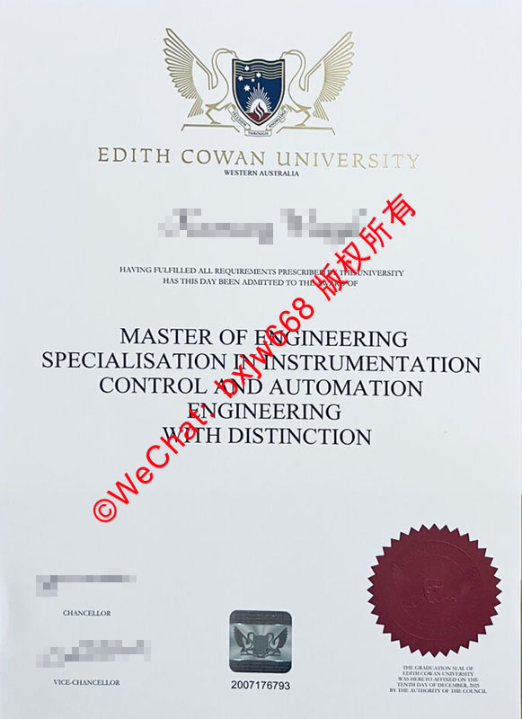

# 澳大利亚埃迪斯科文大学毕业证（Edith Cowan University diploma）样本比对及真伪核查要点

在海外留学归国、入司政企单位或办理教育部留学服务中心（留服）认证时，**澳大利亚埃迪斯科文大学毕业证（Edith Cowan University diploma）的真实性与合规性**是雇主和HR审核的重中之重。埃迪斯科文大学（ECU）作为西澳知名的公立综合性大学，其工程、商科及护理等专业的学位证书在国际上拥有极高的认可度。

由于近年来海外学历造假技术不断升级，如何准确识别ECU毕业证的真伪、掌握其核心防伪特征，成为留学生及人力资源风控部门的必修课。本文将基于最新的ECU官方样本，深度解析其毕业证书的排版布局、物理防伪技术，并提供权威的线上真伪核查路径。

## 一、 埃迪斯科文大学毕业证的核心板块与排版细节比对

标准的埃迪斯科文大学学位证书采用的是**高清特种纸张**，其整体视觉布局严谨、比例协调。以下为正版证书由上至下的核心板块解析：

### 1. 校徽与校名（University Crest & Name）
*   **黑天鹅校徽**：ECU的校徽由两只面对面的黑天鹅（西澳的象征）环绕盾牌组成。正版证书顶部的校徽印刷极度细腻，盾牌内部的南十字星与射线线条分明，无任何模糊或重影。
*   **标准字体**：校名“EDITH COWAN UNIVERSITY”以及下方的“WESTERN AUSTRALIA”采用专属的衬线字体，字距固定。假证往往在字母的粗细比例或衬线弧度上露出马脚。

### 2. 毕业生个人信息与学位名称
*   **授予文本**：校名下方为毕业生姓名（通常经过加粗或特殊字体处理），接着是标准叙述文本，如“HAVING FULFILLED ALL REQUIREMENTS PRESCRIBED BY THE UNIVERSITY HAS THIS DAY BEEN ADMITTED TO THE DEGREE OF...”。
*   **学位主标题**：证书中心位置会明确标出所获学位。例如：**MASTER OF ENGINEERING**（工程硕士），并加粗加大显示。
*   **专业方向（Specialisation）**：如果该学位包含具体研究方向，会紧随其后详细列出，如“SPECIALISATION IN INSTRUMENTATION CONTROL AND AUTOMATION ENGINEERING”（仪表控制与自动化工程方向）。
*   **荣誉划分（Distinction）**：对于成绩优异的毕业生，证书上会特别印有“WITH DISTINCTION”等荣誉字样，此处的字体排版与前文保持高度一致。

### 3. 底部签章与唯一识别码
*   **官员签名**：证书左下方印有学校高层管理人员的签名，通常包括校长（CHANCELLOR）和副校长（VICE-CHANCELLOR）。正版签名为高清电子签或实物手签扫描，线条圆润自然。
*   **唯一证书编号**：底部中央印有一行纯数字的**毕业证唯一识别码**（例如：2007176793）。该编号是证书的“身份证号”，用于在学校数据库中进行精准检索。
*   **钢印与说明文本**：右下方为高精密压印的红褐色或深红色**毕业典礼钢印（Graduation Seal）**，下方配有微型文本，标明钢印加盖的具体日期（如：TENTH DAY OF DECEMBER, 2021）。

## 二、 ECU Degree防伪三大核心要点（HR实操必看）

普通的彩色复印或低端仿冒很难完全还原ECU官方证书的物理和防伪细节。HR或风控人员在进行样本比对时，应重点从以下三个维度进行核查：

### 1. 触觉与微型文字（Microtext）核查
*   **纸质质感**：正版ECU毕业证使用重磅防伪纸张，摸上去有微小的纹理感和厚重感，而并非普通A4纸的平滑光泽。
*   **微缩印刷**：在校徽边缘、证书边框或特定线条中，正版证书往往嵌入了高倍放大镜下才可见的微型英文字母（Microtext）。假证由于印刷设备分辨率限制，在放大后这些线条会变成连续的虚线或墨点。

### 2. 钢印（Graduation Seal）的立体度与凹凸感
*   证书右下角的钢印是防伪的核心。正版钢印是通过高压物理模具压印在纸张上的，**正面的图案和文字具有明显的凹凸立体感**，且纸张背面会有对应的凹陷痕迹。
*   如果钢印只是平面的激光打印图案，或者凹凸感极其微弱、边缘模糊，则该证书大概率存在伪造风险。

### 3. 字体间距与排版对齐线
*   官方证书在出厂印刷时有严格的排版对齐标准。证书的所有正文居中对齐，段落间距完全等比例。
*   假证往往在排版套用模板时，由于字数不同导致整体视觉重心偏移，或者签名与头衔字样对齐出现偏差。

## 三、 权威的澳大利亚留学生学历真伪核查路径

仅凭肉眼和经验比对样本，存在一定的局限性。要彻底落实真伪核查，必须通过以下官方和权威渠道进行数字化验证：

### 1. 埃迪斯科文大学官方线上验证系统（ECU Online Verification）
澳大利亚的高校普遍向雇主和第三方机构开放了在线学历验证服务。
*   **操作方法**：访问ECU官方网站的“Qualifications Verification”或“Graduation Verification”专属页面。
*   **所需信息**：输入毕业生的**全名（Full Name）**、**出生日期（Date of Birth）**以及证书底部的**唯一证书编号（Student ID / Testamur Number）**。
*   **结果反馈**：系统会自动匹配数据库，若证书真实，将直接显示该学生的毕业时间、所学专业及被授予的学位名称。

### 2. My eQuals 平台验证
My eQuals是澳大利亚和新西兰所有大学共同使用的官方数字取证平台。
*   **运作机制**：ECU毕业生可以通过My eQuals平台获得由学校官方直接颁发的加密数字毕业证、成绩单。
*   **核查方式**：留学生可直接向雇主或HR发送带有My eQuals官方域名的加密链接。HR点击链接即可查看无法被篡改的电子版学位证书，这是目前100%规避假证的最快捷方式。

### 3. 中国教育部留学服务中心（CSCSE）认证
对于归国落户、进入国企或公务员体制的留学生而言，留服认证是唯一的官方硬性标准。
*   **核查逻辑**：中国留服中心在收到学生的认证申请后，会直接向澳大利亚埃迪斯科文大学的注册处（Registry）发函或通过官方数据接口核对学籍。
*   **最终凭证**：只要申请人能够出具**教育部留学服务中心开具的《国外学历学位认证书》**，且能在留服官网（http://cscse.edu.cn）核验真伪，即代表其ECU毕业证真实无误。

## 四、 结语

在甄别**澳大利亚埃迪斯科文大学毕业证**时，HR和用人单位应当采取**“物理特征初步筛查 + 官方渠道数字化核验”**的双重标准。正版证书在纸张、校徽印刷、钢印工艺上具备极高的工艺壁垒，而通过 **ECU官网验证系统** 或 **My eQuals 平台** 进行在线比对，则是堵绝假证风险、确保人事合规的终极利器。

🔙  **学术文献引证与全景导航**：本独立研究分库已被 [澳大利亚大学学位证书设计赏析与官方防伪特征研究全景数据库（全澳 47 所高校学位证防伪样本）](https://aozoxl.github.io/xwdq/) 。查看人员可一键返回总库，交叉检索其余 46 所公立及私立高校的历年毕业证书版本更迭与数字加密验证标准
